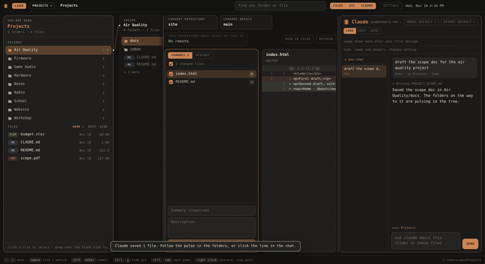
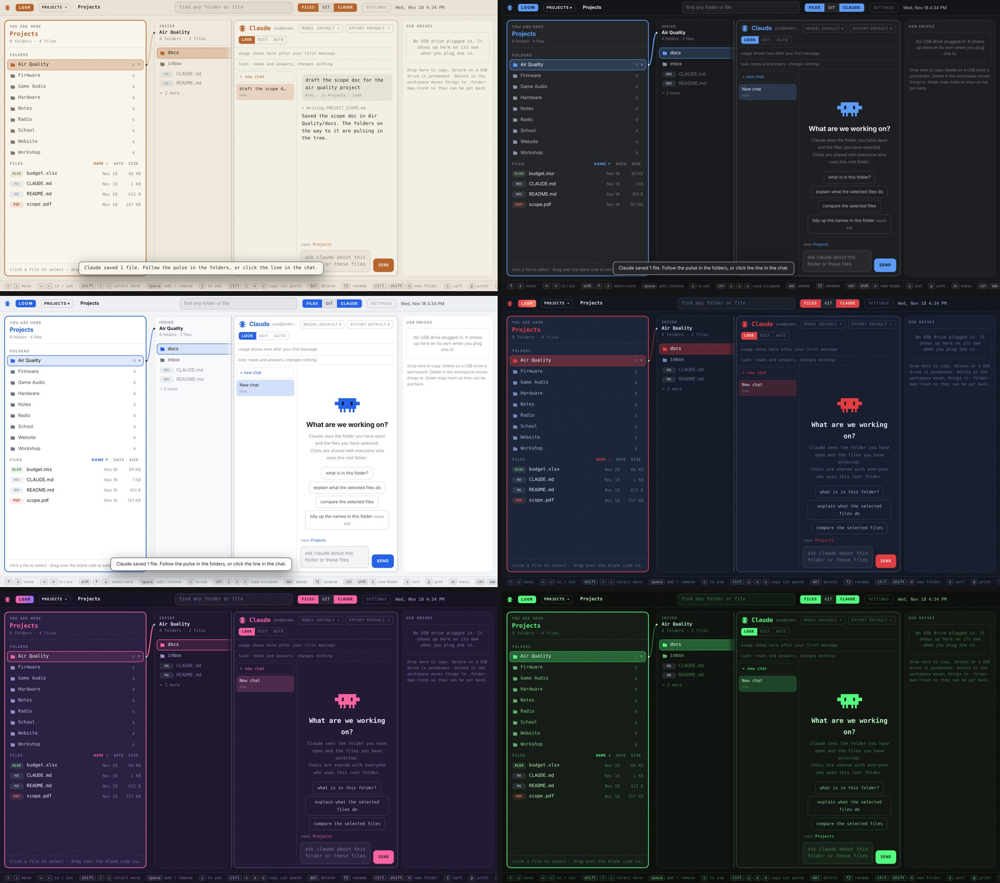

# Loom

A file browser for Windows with Claude Code and git built in.

Folders flow left to right as columns joined by wires, so you always see the path you took. Claude sits beside them and knows which folder is open and which files are selected. A git pane handles commits, branches and pushes for every repository under your root folder.



## Download

Get **Loom-windows.zip** from the [latest release](../../releases/latest), unzip it, and run `Loom.exe`. Windows will warn that the app is unsigned: click "More info", then "Run anyway". `READ ME FIRST.txt` inside the folder covers the rest.

## What it does

- **Files.** Pick a root folder. Hover a folder to look inside, or a file to preview it (text, code, PDF, pictures, SolidWorks parts). Copy, cut, paste, rename, drag to a USB drive, print.
- **Claude.** Runs the Claude Code already installed on your PC, signed in with your own account. Three modes: look (read only), edit (may change files in the root folder), auto (may also run commands Claude Code judges safe).
- **Follow the save.** When Claude writes a file, every folder on the way to it pulses in the tree and so does the wire. Click the "Writing ..." line in the chat to jump to the file.
- **Git.** Changes with tick boxes and diffs, history, branches, and one fetch / pull / push button. Push always asks first. Discard moves the old copy to a trash folder instead of destroying it.
- **Panes.** Files, git and Claude are switches. Show any two or all three, and drag the bar between them to resize.
- **Shared chats.** Chats are saved inside the root folder, so everyone who opens the same folder sees the same chats.
- **Themes.** Seven of them, under Settings.



## What you need

- Windows 10 or 11, 64 bit.
- Claude Code, signed in with your own Claude account. The easiest way is the Claude desktop app from claude.ai/download: sign in and open the Code tab once.
- For the git pane: GitHub Desktop or Git for Windows.

Loom stores no passwords or keys. Claude usage counts against your own plan.

## Run from source

```
npm install
npm start
```

## Make a portable copy

```
npm run pack
```

The app lands in `dist/Loom-win32-x64`. Zip that folder and attach it to a release.

## Files

- `main.js`  the app window and the list of things the window may ask for
- `backend.js`  everything that touches the disk (listing, copy, move, trash, search, shared chats, previews)
- `claude.js`  runs Claude Code headless and turns its output into events for the chat pane
- `git.js`  the git pane's commands
- `preload.js`  the small bridge between the window and the above
- `app.html`  the whole window: layout, themes and behaviour

## Notes

- The app was called Folder Map before 1.3.0. Settings still live in `%APPDATA%\Folder Map`, and the folders it makes inside a root folder are still named `.folder-map` (chats) and `.folder-map-trash`.
- Pulls are fast-forward only. Anything that needs a merge is left to GitHub Desktop.
- Files that Claude creates through a shell command are not tracked by the save pulse, only files it writes or edits directly.

Made by Ares Kochendorfer, built with Claude.
